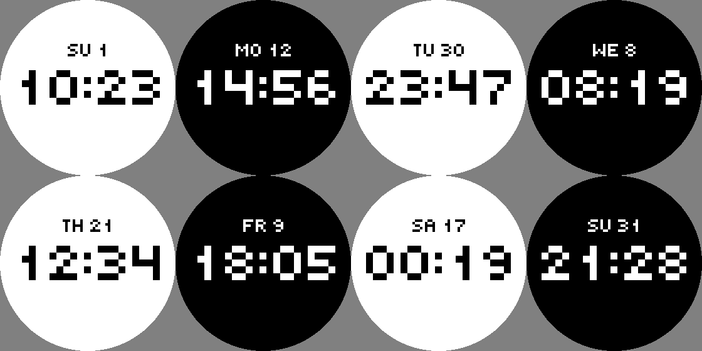
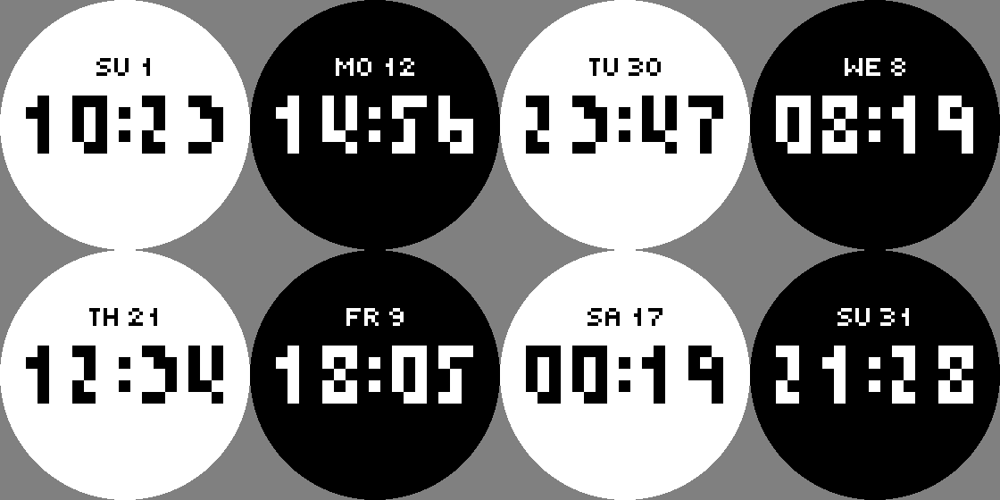
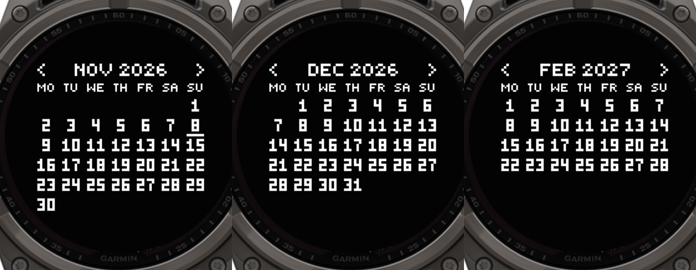

# Pixel Time

Esfera pixelada y minimalista para relojes Garmin con pantalla MIP. Muestra la hora en bloques macizos, con el día encima y un calendario mensual al mantener pulsada la pantalla.

Diseñada y probada para **tactix 8 Solar 51 mm** / **fēnix 8 Solar 51 mm** (ID de Connect IQ: `fenix8solar51mm`).

| Estilo redondeado | Estilo anguloso |
|---|---|
|  |  |



## Funciones

- **Hora pixelada** en dos estilos de dígitos: *Redondeado* (4×5) y *Anguloso* (3×5).
- **Día de la semana y del mes** encima de la hora: `MO 12`, `TU 3`, `WE`, `TH`, `FR`, `SA`, `SU`.
- **Fondo blanco o negro**, con los colores invertidos.
- **Calendario mensual**: mantén pulsada la pantalla para abrirlo. Con el calendario abierto, una pulsación larga a la izquierda muestra el mes anterior, a la derecha el siguiente y en el centro vuelve a la hora. El día actual aparece subrayado.
- Respeta el formato de 12/24 h del reloj.
- Bajo consumo: se refresca una vez por minuto y no usa fuentes ni imágenes externas.

## Instalación

1. Descarga `PixelTime.prg` desde la [última release](../../releases/latest).
2. Cierra Garmin Express y conecta el reloj por USB.
3. Copia el archivo en `GARMIN\APPS`.
4. Expulsa el reloj y desconéctalo.
5. Mantén pulsado **UP/MENU** sobre la esfera, entra en **Esfera** y elige **Pixel Time**.

## Ajustes

En el reloj: mantén pulsado **UP/MENU**, entra en **Esfera** y en **Personalizar**.

| Ajuste | Opciones |
|---|---|
| Estilo | Redondeado / Anguloso |
| Fondo negro | Sí / No |

Como la esfera se instala a mano, estos ajustes no aparecen en la app Garmin Connect.

## Compilar desde el código

Necesitas el [Connect IQ SDK](https://developer.garmin.com/connect-iq/sdk/) con el dispositivo *fēnix 8 Solar 51mm*, y una clave de desarrollador.

```bash
monkeyc -f monkey.jungle -d fenix8solar51mm -o PixelTime.prg -y /ruta/a/developer_key
```

También puedes usar la extensión **Monkey C** de VS Code con el comando `Monkey C: Build for Device`.

Los tamaños, separaciones y glifos se pueden ajustar con las constantes del principio de [`source/PixelTimeView.mc`](source/PixelTimeView.mc).

## Licencia

[MIT](LICENSE)
